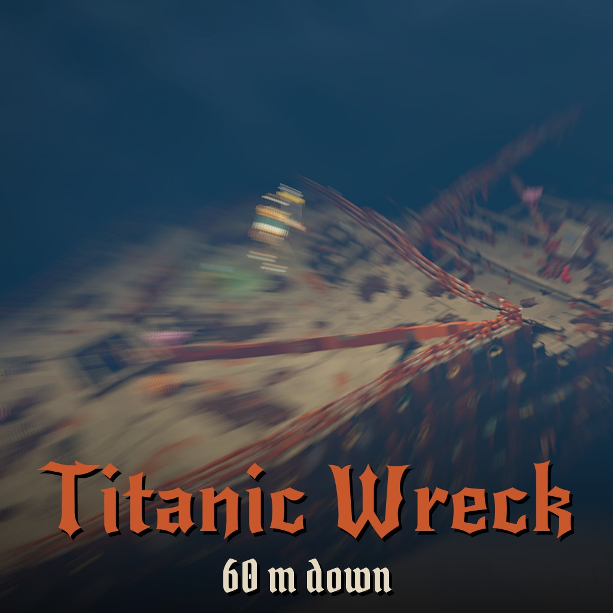

# Titanic Wreck - 60 m down

On the Steam Workshop: [Titanic Wreck](https://steamcommunity.com/sharedfiles/filedetails/?id=3833158777)

**Needs the [Underwater Exploration](https://steamcommunity.com/sharedfiles/filedetails/?id=3829332491) mod**: subscribe to it and turn it on under Global mods. The diving, the air, the harpoon and the stations all come from it.

The wreck of RMS Titanic on the sea floor: the bow driven into the mud, the crushed stern torn off beside it, and the debris of the break scattered between them. Rebuilt deck by deck from the 1911 builders' plans, then aged by a hundred years under water, with roomier doorways and corridors so you can swim it.

## Diving
- You start on a platform at the surface. **Crouch** in the water to dive, swim where you look, **jump** and **crouch** go straight up and down.
- Your tank holds **2 minutes** of air. Refill at the **green air stations** (E): on the three shot lines down from the surface and inside the wreck.
- Below about 25 m you need your **flashlight**.

## What to find
The forecastle, the Grand Staircase shaft, the D-deck reception room and the first class dining saloon, Scotland Road, the Turkish bath, the boiler rooms and the engines, the torn decks at the break and the stern's collapsed decks.

## Not alone
Turn on the **Abyssipede** global mod and something long hunts you through the decks.

## Multiplayer
Made for diving with friends. The host turns on Underwater Exploration (and Abyssipede, if you dare).

## Install

Subscribe on the [Steam Workshop](https://steamcommunity.com/sharedfiles/filedetails/?id=3833158777), or clone this repository into
`Documents/Teardown/mods/titanic wreck`. Play it from the **Mod manager** (Local files), or host it in multiplayer.

## Credits

Made by AgeOfAlgorithms and Claude (Anthropic). MIT licence.
